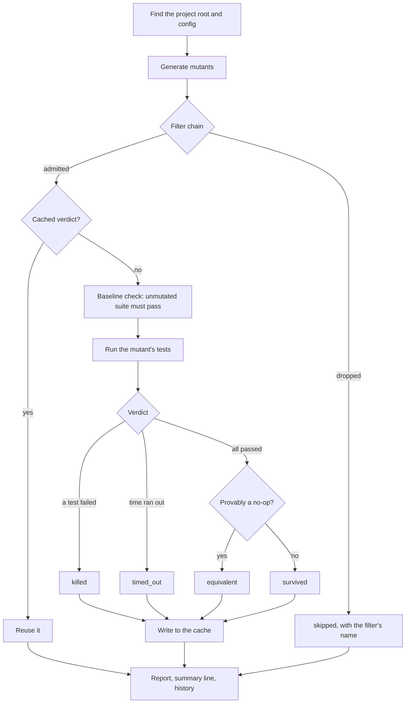

# How a run works

What `fermut run` does between reading your config and printing the summary
line. Each step links to the page with the details.

## 1. Project and config

The **project root** is the nearest directory above the source root with a
project marker: `pyproject.toml`, `setup.cfg`, a pytest/tox config,
`setup.py`, or `.git` ([Projects](projects.md)). fermut reads `fermut.toml` or
`[tool.fermut]` there; command-line flags override it
([Configuration](configuration.md)). Paths in reports are resolved against
it, and the coverage data must match it.

## 2. Generate mutants

fermut parses every `.py` file under the source root with Ruff's parser and
applies each [operator](../reference/operators/index.md) wherever it fits:
`<=` → `<`, a return value → `None`, and so on. Each mutant gets an id from
its file, byte offset, operator and edit, so the same code always yields the
same ids. Nothing runs yet; [`fermut list`](../reference/cli/list.md) stops
here and prints them.

## 3. Filter chain

Cheap checks run first, so the expensive ones see as few mutants as
possible. In order: operator selection (experimental, the default
`migrations` skip, parity, the
[operator profile](../reference/operators/profiles.md), `--ops` /
`--skip-ops`), `--shard`, `--sample`, `--diff-only` / `--since`, then
**coverage** (no test executes the line), `--select-tests`, the optional
`ruff` check, the **`ty` type check** (the mutant introduces a type error),
and the optional bytecode check (`--tce`). A dropped mutant is reported as
`skipped` with the filter's name, and never counts toward the score
([JSON output → filter values](../reference/json.md#outcomes)).

On a typical run most mutants stop here. On pyjwt, only 1,730 of 6,475
generated mutants were scored
([benchmarks](../reference/benchmarks.md)); the rest were skipped.

## 4. Cache

For each admitted mutant, fermut looks up a verdict stored under the mutant
id, an AST hash of its file, and a scope covering the run settings and the
tests that cover it. A hit is reused without running anything. A changed
test file normally misses, but a cached kill still counts if the test that
killed it hasn't changed. If every mutant is a hit, the run tests nothing
and finishes in well under a second ([Caching](caching.md)).

## 5. Baseline check

Before the first mutant runs, fermut runs your unmutated suite once. If it
fails, fermut stops: a red suite would make every mutant look killed. The
baseline's wall time also sizes the per-mutant timeout when a
`--timeout-factor` budget is on.

## 6. Run each mutant

Workers run mutants in parallel (`--jobs`), each in its own copy of the
project ([Isolation](../reference/cli/run-isolation.md)), so a patched file
never touches your source tree.

- **Which tests.** Only the tests that executed the mutated line, according
  to per-test coverage ([Test selection](../reference/cli/run-test-selection.md)),
  ordered so the test that killed this code before runs first. pytest stops
  at the first failure (`-x`).
- **How.** With pytest on Unix, the mutant runs in a fork of one pytest
  process that has already imported and collected your suite, instead of a
  fresh pytest ([Schemata](../reference/cli/run-schemata.md)). Anything a
  fork can't vouch for runs the normal way.
- **Limits.** Each run has a timeout, and a memory cap so a runaway mutant
  can't take the machine down ([`fermut run`](../reference/cli/run.md#memory-cap)).

## 7. Verdict

| Result | Status |
|---|---|
| A selected test failed | `killed` |
| The run hit its timeout | `timed_out`: counted as detected, since the change was observable |
| Every selected test passed | `survived`, unless the equivalence check proves the edit can't change behaviour, in which case `equivalent` ([Equivalent mutants](../guides/equivalent-mutants.md)) |
| fermut couldn't get a verdict | `error`: not counted ([Errored outcomes](../reference/troubleshooting/errored-outcomes.md)) |

Verdicts go into the cache for next time.

## 8. Report

The score is `(killed + timed_out) / (killed + timed_out + survived)`.
`skipped`, `equivalent` and `error` count on neither side
([Mutation score](mutation-testing.md#the-mutation-score)). fermut prints
the survivors and the summary line, writes any reports you asked for
(`--json`, `--markdown`, `--junit`, `--html`), and appends an entry to
`.fermut/history.jsonl` for [`trend`](../reference/cli/trend.md) and
[`score`](../reference/cli/score.md). The exit code is non-zero if any
mutant survived, or with `--fail-under`, if the score is below it.
