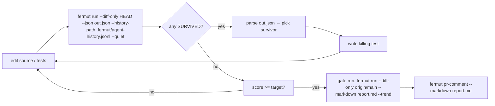

# Coding agents

fermut is built for **coding agents** as much as it is for humans. The
inner loop of mutation testing — write code, run mutants, read survivors,
write a killing test, re-run — matches the way agents already work:
short cycles, machine-readable output, deterministic results.

This page explains how to drive fermut from an agent (Claude, Cursor,
Aider, your own scaffolding) and which design decisions in fermut exist
specifically to make those loops fast and reliable.

## Why fermut works well for agents

| Need an agent has                                                          | What fermut gives it                                                                                                                              |
|----------------------------------------------------------------------------|---------------------------------------------------------------------------------------------------------------------------------------------------|
| Short iteration cycles (write → measure → write)                            | Per-mutant result cache keyed on `(mutant.id, ast_hash(file), scope)`. Note the mutant id embeds the byte offset, so any edit that shifts bytes (including a comment) re-runs the mutants below it. See [Cache strategy](#cache-strategy). |
| Machine-readable output                                                    | `--format json`, `--json <path>`, `--junit`, structured fields in every report writer.                                                            |
| Deterministic results across runs                                          | Pinnable Hypothesis seed, deterministic `--sample`, content-hash cache keys. Two runs of the same commit produce the same survivor list.            |
| Knowing *which test to write next*                                          | `fermut next` ranks survivors by cluster leverage + kill-ease and names the single best target; survivor JSON lines carry file:line, operator, original → replacement for the concrete assertion. |
| Knowing *if my work is helping*                                             | `.fermut/history.jsonl` + `fermut trend`. Score delta vs the previous iteration is the agent's reward signal.                                       |
| Targeting only the code the agent just touched                              | `--diff-only` for branch-relative diffs (merge base → working tree), `--since <SPEC>` for "since I last ran" (fixed point → working tree). Both **include uncommitted** edits. |
| Narrowing tests per mutant so each iteration runs in seconds, not minutes  | Coverage-driven test selection from `.coverage` (per-test contexts). fermut reads coverage.py's native `.coverage` SQLite DB directly and auto-discovers it at the project root; `pytest --cov=src --cov-context=test` is all it takes. |
| Failing loud when the environment is broken                                 | `fermut doctor` returns exit code 1 with a remediation hint per failed check.                                                                       |

## One concrete cycle

End-to-end agent iteration on a Python repo. Each numbered step takes
seconds in steady state.

**1. Edit one file** — say `src/auth.py`, tightening a boundary check.

**2. Run fermut, write JSON** — `--diff-only HEAD` scopes mutants to
lines edited since the last commit; cache reuses verdicts for everything
else. (`--diff-only HEAD` behaves like `--since HEAD` but also overrides a
`diff_only = "main"` key from a `pr-gate` config; `--since` would collide
with that key and error out.)

```sh
fermut run src/ --tests tests/ \
    --diff-only HEAD \
    --coverage .coverage \
    --json .fermut/last.json \
    --history-path .fermut/agent-history.jsonl --quiet
```

`--history-path` keeps the noisy iteration runs out of the shared
`.fermut/history.jsonl` while still recording them, so `fermut score` /
`fermut trend` (pointed at the same file) have something to compare.

Stderr prints one progress line. Score and survivors land in
`.fermut/last.json`.

**3. Pick the next survivor** — agent parses JSON, sorts by operator,
takes the first.

```sh
jq '[.outcomes[] | select(.status == "survived")]
    | sort_by(.mutant.operator) | first | .mutant' .fermut/last.json
```

Returns:
```json
{ "id": "/abs/repo/src/auth.py@812:boundary-shift:>=->>", "file": "/abs/repo/src/auth.py",
  "line": 42, "operator": "boundary-shift",
  "original": ">=", "replacement": ">" }
```

The `id` grammar is `<file>@<byte-offset>:<operator>:<original>-><replacement>`
(with `exp:` before the operator for an experimental one; see [JSON output](../reference/json.md#mutant)).
`original` / `replacement` are the operator token only, not the whole
expression. **Caveat for agents that store ids across runs:** `<file>` is
always the absolute path (even for `fermut run src/`), so ids captured on one
machine/checkout won't match another.
Don't persist ids as cross-machine keys; re-read them from each run's JSON, or
key your own state on the stable `file` + `line` + `operator` fields instead.

**4. Write a killing test** — agent opens `src/auth.py:42`, reads the
enclosing function, drops a test that asserts behavior at `age = 18`
exactly. Or asks `fermut explain --format json` for an operator-aware
hint + pytest skeleton.

**5. Re-run, watch the score delta** — only `auth.py`'s mutants
re-evaluate (cache hit on the rest). Boundary mutant moves from
`survived` → `killed`. `fermut score --history-path .fermut/agent-history.jsonl` reports
`"delta": 0.7`.

Loop on step 1 until the score clears the target or every survivor
is justified as equivalent / acceptable. On pyjwt, a cycle after editing
one function took about 11 seconds with `--diff-only HEAD`, nearly all of
it the baseline run of the unmutated suite; the cycle cost tracks your
suite's run time, not the repo's size.

## The recommended agent loop



Two distinct runs: the inner loop records to a scratch history
(`--history-path .fermut/agent-history.jsonl --quiet`) so its noisy iterations stay out of the
shared log but `fermut score` still has a delta to read; the gate run uses
the default history and adds `--trend` + `--markdown` for the PR comment. Don't mix them.

Key invariants:

1. **Don't re-run the full sweep every iteration.** Use `--diff-only`
   (CI workflow) or `--diff-only HEAD` (local, uncommitted edits), so the agent only burns
   wall-clock on lines it changed.
2. **Always read `out.json`, not stdout.** Stdout is for humans. JSON is
   stable across releases per the [versioning policy](https://github.com/KovantAI/fermut/blob/main/VERSIONING.md).
3. **Cache is the single biggest performance lever.** Default cache path
   `.fermut/cache.json` is the right answer — never disable it on the
   agent's primary loop. See below.
4. **Pin determinism.** Set `hypothesis_seed` in `fermut.toml`. Without
   it, Hypothesis-driven tests can mask or fabricate survivors between
   runs and the agent will chase ghosts.
5. **Generate coverage with `fermut coverage`.** A `.coverage` it wrote
   is refreshed by `fermut run` whenever a source or test file's content
   changed, re-running only the affected test files. A stale `.coverage`
   from bare pytest-cov is ignored instead (the run logs `ignoring
   auto-discovered coverage …` and repeats it under the summary), so
   every mutant runs the whole suite and uncovered lines count as
   survivors: on pyjwt, one edited function turned a 38 s run into 311 s
   and nearly doubled the survivors. Never commit the coverage file.

## Cache strategy

The cache is what makes iterating cheap. Every verdict is stored under
`(mutant.id, ast_hash(file), scope)`: the file hash is AST-structural, so
reformatting and comment edits keep it, and `scope` covers the run
settings plus the tests that run against the mutant. An agent editing one
file pays only for that file's mutants, and adding a killing test re-runs
only the mutants that test covers.

For an agent that means:

- **Never pass `--no-cache` in the loop.** Re-running every mutant every
  iteration is the dominant cost.
- **Don't clear the cache as a habit.** `fermut clean` is for a fermut
  upgrade or a survivor you can't reproduce by hand; it keeps
  `history.jsonl`, so the trend survives.
- **In CI, persist `.fermut/cache.json`** with `actions/cache`, keyed on the
  lockfile and sources (the [GitHub Action](github-action.md) does this for
  you), and give each shard its own `--cache-path`.

The full key, what is and isn't cached, and when to clear it are in
**[Caching](../concepts/caching.md)**.

## Trend tracking is the agent's feedback signal

What tells an agent whether an iteration helped is the **score change since
the previous run**, not the absolute score.
[`fermut score`](../reference/cli/score.md) computes it from the history log:

```sh
fermut score --history-path .fermut/agent-history.jsonl --format json
```

```json
{ "score": 85.7, "delta": 3.7, "baseline_score": 82.0,
  "new_survivors": [], "newly_killed": ["/repo/src/auth.py@812:…"],
  "regressed": false }
```

`regressed` is `true` when the score dropped or a previously killed mutant
survives again. `--baseline N` compares against `N` runs back;
`--fail-on-regression <pts>` makes it exit non-zero, for a gate. All
fields: [JSON output → `fermut score`](../reference/json.md#fermut-score).

How an agent's outer loop can act on it:

```python
r = fermut_score()                 # the JSON above
if r["regressed"]:
    revert_last_edit()             # worse, or a kill came back
elif r["delta"] is not None and r["delta"] < 0.5 and not r["newly_killed"]:
    pick_different_survivor()      # plateau: the last edit didn't help
else:
    commit_iteration()
```

Pin `hypothesis_seed` and keep the cache on, or the delta is noisy and the
revert rule fires on regressions that aren't real. For the whole history,
use [`fermut trend`](../reference/cli/trend.md).

## Driving fermut programmatically

The inner-loop invocation is the one in [One concrete cycle](#one-concrete-cycle).
Once the agent decides to record progress (e.g. before committing), drop
the scratch `--history-path` and add `--trend` to the run that produces
the PR report:

```sh
fermut run src/ --tests tests/ \
    --diff-only origin/main \
    --markdown report.md \
    --trend \
    --json .fermut/last.json
```

### JSON size and context budget

Each outcome carries the mutant (`id`, `file`, `line`, `operator`,
`original`, `replacement`, `range`), its `status`, and for some statuses
one extra field. Most of its size is the absolute source path, which
appears twice (in `id` and `file`). Measured on pyjwt (6,475 mutants,
paths like `/home/runner/work/pyjwt/pyjwt/jwt/api_jwt.py`), that comes to
**about 100 tokens per outcome**, and **about 650k tokens** for the whole
report. Longer checkout paths cost more.

| Mutants in report | Approx tokens (full JSON) | Strategy |
|------------------:|---------------------------|----------|
| ≤ 500             | ≤ ~50k                    | Feed the whole report; let the model pick the next survivor. |
| 500 – 5,000       | ~50k – 500k               | Filter to `status == "survived"` first; most outcomes are `killed` or `skipped` and add no signal. |
| > 5,000           | > ~500k                   | Don't read the JSON directly. Use `fermut next --max-tokens N`, or `fermut explain --format json <id>` per survivor. |

The least-effort path at any size is **[`fermut next --max-tokens N`](../reference/cli/next.md#token-budget)** —
it filters to survivors, ranks them, trims the fields, and fits the result
into a token budget, dropping the rest with a stderr note. No jq, no
manual field selection:

```sh
fermut next .fermut/last.json --max-tokens 2000
```

If you'd rather hand-filter — survivors only, with the fields the model
actually needs:

```sh
jq '[.outcomes[]
     | select(.status == "survived")
     | {id: .mutant.id, file: .mutant.file, line: .mutant.line,
        operator: .mutant.operator,
        original: .mutant.original, replacement: .mutant.replacement}]' \
    .fermut/last.json
```

Dropping every non-survivor is what matters: on pyjwt the 712 survivors
in this shape came to about 51k tokens, under 10% of the full report.
Trimming the fields saves another ~30% per survivor. A 200k context fits
roughly 2,800 survivors in this shape.

### Parsing survivors from JSON

Every field of the run report, and of the `next`, `explain` and `score`
output, is described in **[JSON output](../reference/json.md)**. Two rules
matter most:

- Read `summary.scored` before `summary.mutation_score`: with `scored == 0`
  the score is a placeholder `100.0`, not a perfect run.
- To pick the next survivor, use [`fermut next`](../reference/cli/next.md)
  rather than sorting outcomes yourself. It groups survivors by
  `(file, operator)`, ranks the groups by how many one test is likely to
  kill and how easy that test is, and gives the score gain for killing one
  (`min_gain_pts`) or the whole group (`max_gain_pts`).

```sh
jq '.summary | {score: .mutation_score, scored}' .fermut/last.json
fermut next .fermut/last.json --limit 5
```

### `explain`, `suggest` and `autofix`

**An LLM-driven agent should use `explain --format json` and write the test
itself.** `explain` makes no network calls: it returns the source around
the mutant, the enclosing function, an operator-specific hint, the tests
that ran the line without noticing, and a pytest skeleton
([fields](../reference/json.md#fermut-explain-format-json)). The agent
already has the repo in context, so its test will fit better than one from a
second, context-free model call.

```sh
fermut explain .fermut/last.json <id> --format json
```

**A driver that isn't an LLM** (a shell script, a CI job) can have fermut
write tests through the Anthropic API instead:

- [`fermut autofix`](../reference/cli/autofix.md) generates a test, keeps it
  only if it kills the mutant and the suite stays green, and reverts the
  rest. Prefer it for unattended runs.
- [`fermut suggest`](../reference/cli/suggest.md) only generates; with
  `--apply` it appends to your test files without verifying. Review before
  committing: the model may call helpers your project doesn't have.

Both cost an API call per survivor, cached by file and prompt, so a re-run
on unchanged source is free. Why there's no MCP tool for test generation:
[`fermut mcp`](../reference/cli/mcp.md#no-generation-tools).

### `fermut doctor` as a preflight

Before the first `run`, an agent should preflight:

```sh
fermut doctor --strict
```

This fails loud (exit 1) when the environment is misconfigured —
missing pytest, Python < 3.10, the coverage file lacks per-test contexts
(the format-aware `coverage-data` check validates either a `.coverage` SQLite
DB with a populated `context` table or a JSON export with `"contexts"`),
etc. — and prints a one-line remediation hint per failure. Better than
discovering the same problem ten mutants into a run.

Note the `hypothesis_seed` check is **conditional**: `doctor` only warns
about an unpinned seed when the project actually depends on Hypothesis
(pinning one otherwise is pointless), so a clean `doctor` on a non-Hypothesis
repo is expected — it isn't skipping the check.

## MCP server { #mcp-server }

`fermut mcp` runs a [Model Context Protocol](https://modelcontextprotocol.io)
server over stdio, so an agent calls fermut as native tools
(`fermut_doctor`, `fermut_baseline`, `fermut_run`, `fermut_next`,
`fermut_explain`, `fermut_score`, `fermut_list_survivors`,
`fermut_coverage`) instead of
shelling out and parsing JSON. See the
**[`fermut mcp` reference](../reference/cli/mcp.md)** for the tool list
and error model.

The [Claude Code plugin](claude-code-skill.md#option-2-the-claude-code-plugin)
registers the server for you, alongside the agent skill. To register it
yourself in Claude Code:

```sh
claude mcp add fermut -- fermut mcp
```

Or in a client config that takes a server map. For Cursor, put this in
`.cursor/mcp.json` at the project root (this project only) or
`~/.cursor/mcp.json` (every project):

```json
{
  "mcpServers": {
    "fermut": { "command": "fermut", "args": ["mcp"] }
  }
}
```

The server honors the project's `fermut.toml`, so run it from (or point
the client's working directory at) the project root. No network access,
no API key: the tools wrap the same local engine the CLI uses.

## Anti-patterns

- **Disabling the cache.** `--no-cache` is for one-off debugging, not
  for the loop. Re-running every mutant every iteration is the dominant
  cost.
- **Re-running the full sweep every iteration.** Use `--diff-only HEAD` or
  `--diff-only main` so the cache hit ratio stays high.
- **Reading stdout instead of JSON.** Stdout formatting is human-tuned;
  no API guarantee. For `explain` / `suggest`, pass `--format json` —
  the schema is part of the versioned contract.
- **Letting `suggest` write to source without review.** `--apply`
  appends to your test files. Always diff before committing — the model
  may invent imports or helpers.
- **Calling `suggest` from inside an LLM-driven agent.** Doubles the
  LLM round-trip and loses the agent's repo context. Prefer
  `explain --format json` and let the agent write the test itself.
- **Ignoring `errored` outcomes.** Errors are not survivors but they
  *are* signal — the test suite has hidden side-effects on the source
  tree or a transient failure. Don't sweep them under the rug.
- **Touching `history.jsonl` between runs.** The trend log is the
  agent's reward signal; if the agent fiddles with it, the trend
  becomes meaningless.

## Recommended `fermut.toml` for an agent-driven repo

```toml
# Agent-driven mutation testing.
# Optimized for: fast cache hits, deterministic survivors, machine-readable output.

source_root = "src"
tests = "tests"
runner = "pytest"

# Cache is the iteration-speed lever. Never disable in the inner loop.
cache = true

# Trend log is the agent's reward signal. Append on every run.
history = true

# Determinism: same commit → same survivors → meaningful trend deltas.
hypothesis_seed = 12345

# Narrow ops to start. The agent can widen as the score climbs.
ops = ["arith-op-swap", "compare-op-swap", "boundary-shift", "return-value-to-none"]

# ty filter drops type-invalid mutants before they cost a pytest run.
ty_filter = true

# Per-mutant test selection. Big speedup once .coverage exists.
# fermut reads the native .coverage SQLite DB directly and auto-discovers
# it at the project root, so this line is optional — set it to pin the path.
coverage = ".coverage"

# Keep timeouts tight in the inner loop — slow mutants slow the agent.
timeout = 15
```

Use `fermut init --profile pr-gate` to get a config close to this — then
hand-edit. Note `pr-gate` also writes `diff_only = "main"`: pass
`--diff-only <ref>` to re-scope a run, `--no-diff-only` for a full sweep.
`--since` on top of that key is rejected (`--diff-only` and `--since` are
mutually exclusive).
